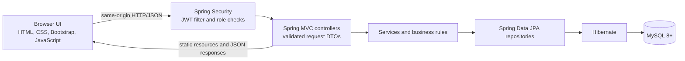
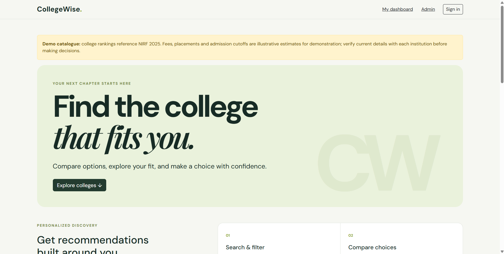
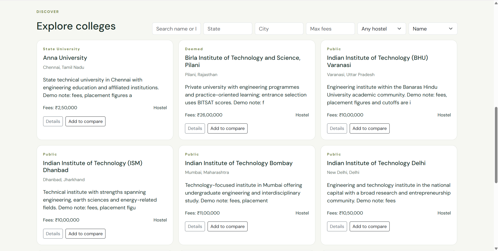
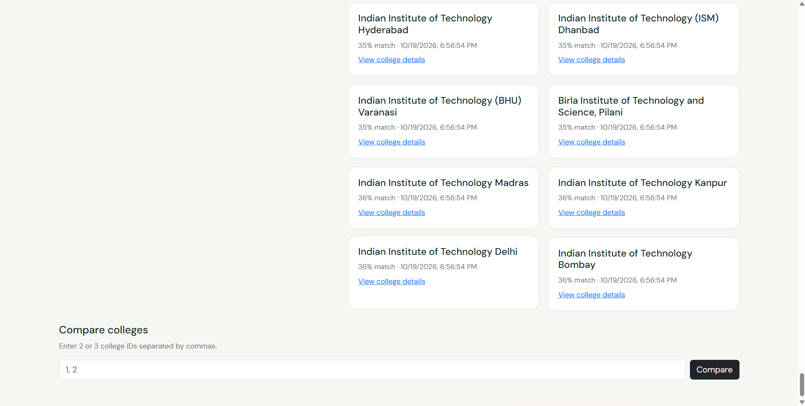
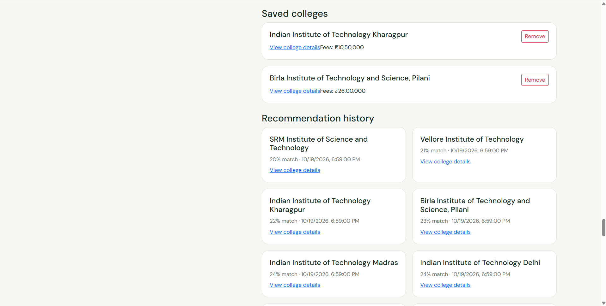
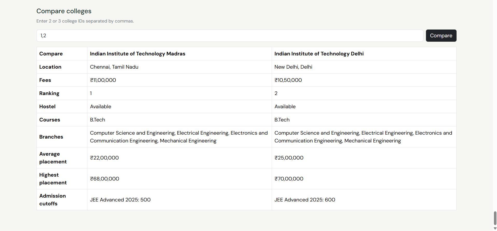
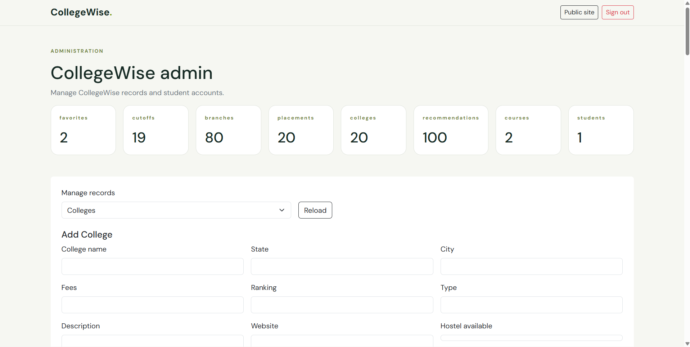

# CollegeWise — Smart College Comparison & Career Guidance System

**Author of the project concept and current Java Spring Boot capstone implementation: Rahul Chandra Sharma**

[](https://www.oracle.com/java/technologies/javase/jdk17-archive-downloads.html)
[](https://spring.io/projects/spring-boot)
[](https://maven.apache.org/)
[](https://www.mysql.com/)
[](https://developer.mozilla.org/docs/Web/HTML)
[](https://developer.mozilla.org/docs/Web/CSS)
[](https://getbootstrap.com/)
[](https://developer.mozilla.org/docs/Web/JavaScript)

[GitHub repository](https://github.com/Er-rahul3707/CollegeWise) · [Java release branch](https://github.com/Er-rahul3707/CollegeWise/tree/release/java-spring-boot) · [Maven workflow](https://github.com/Er-rahul3707/CollegeWise/blob/release/java-spring-boot/.github/workflows/maven.yml)

CollegeWise is a Java full-stack capstone that helps students explore engineering colleges, compare options, save a shortlist, and review recommendations based on their academic and location preferences. Spring Boot serves the REST API and the HTML/CSS/Bootstrap/vanilla JavaScript frontend from one application.

> **Demo-data notice:** catalogue rankings, fees, cutoff values, and placement statistics are illustrative. Recommendation scores are explainable rule-based fit guidance, not admission probabilities or guarantees. Confirm current information with the institution.

## Contents

- [Problem and objectives](#problem-and-objectives)
- [Features and user roles](#features-and-user-roles)
- [Technology stack](#technology-stack)
- [Architecture and workflow](#architecture-and-workflow)
- [Application screenshots](#application-screenshots)
- [Recommendation method and limits](#recommendation-method-and-limits)
- [Database and configuration](#database-and-configuration)
- [Run locally on Windows](#run-locally-on-windows)
- [Student and admin access](#student-and-admin-access)
- [API and health check](#api-and-health-check)
- [Tests](#tests)
- [Documentation](#documentation)
- [Limitations and future enhancements](#limitations-and-future-enhancements)
- [Attribution and licensing](#attribution-and-licensing)

## Problem and objectives

Students often have to compare college options across separate sources for location, fees, courses, entrance cutoffs, and placement information. CollegeWise brings these catalogue fields into one searchable view and provides a consistent way to compare options.

The capstone objectives are to:

- provide searchable college and course information;
- let students save and compare a shortlist;
- use a student profile to produce explainable recommendation matches;
- protect student and administrator operations with role-based authentication; and
- demonstrate a layered Java, Spring Boot, JPA, and MySQL application with a browser frontend.

## Features and user roles

| Role | Capabilities |
| --- | --- |
| Public visitor | Browse, search, filter, sort, and view the seeded college catalogue and college details. |
| Student | Register and sign in; maintain academic and preference details; view recommendations and history; add or remove favorites; compare two or three colleges. |
| Administrator | Sign in through the admin login page; access protected dashboard and manage colleges, courses, branches, cutoffs, placements, and user active status. |

The sample catalogue is initialized idempotently. There are no default student or administrator passwords. Admin provisioning is controlled by environment variables and creates an account only when the configured email is not already present.

## Technology stack

- **Frontend:** HTML5, CSS3, Bootstrap 5, vanilla JavaScript
- **Backend:** Java 17, Spring Boot 3.3.5, Spring MVC, Spring Security, Spring Data JPA, Hibernate, Jakarta Validation
- **Authentication:** JWT, BCrypt password hashing, HttpOnly/SameSite browser cookie
- **Application database:** MySQL 8+
- **Automated test database:** H2, used only by tests
- **Build:** Maven

The app does not require Node.js or a separate frontend server at runtime.

## Architecture and workflow



The browser calls the same-origin REST API. Controllers validate and map requests, services apply application rules, repositories access persisted data, and Hibernate maps entities to MySQL. Spring Security distinguishes student and admin authorities; hiding a button in the frontend is not the authorization boundary.

Main entities include `User`, `StudentProfile`, `College`, `Course`, `Branch`, `Cutoff`, `Placement`, `Favorite`, and `RecommendationHistory`. Relationship details are in [DATABASE_SCHEMA.md](DATABASE_SCHEMA.md).

## Application screenshots

These are genuine application captures. Captions describe the actual visible screen.

### Homepage



### Explore colleges



### Recommendations and comparison selector



### Saved colleges and recommendation history



### College comparison



### Admin dashboard



The available student-dashboard capture is not included in this public gallery because it contains identifiable student profile and academic information. Replace it with a fresh capture using non-personal test data before publishing a dashboard image.

## Recommendation method and limits

Recommendations use deterministic, rule-based scoring from modeled profile and catalogue fields. Factors include budget, location, course and branch, hostel preference, ranking, comparable entrance cutoff, and available placement outcomes. Each result reports contributing reasons and cutoff compatibility when comparable evidence exists. Weights and compatibility behavior are documented in [RECOMMENDATION_ALGORITHM.md](RECOMMENDATION_ALGORITHM.md).

The score is not an admission chance. Missing or non-comparable cutoff evidence is reported as insufficient data. School percentages are not used as eligibility evidence because the current model does not represent institution-specific eligibility rules. Demo data should be validated before making decisions.

## Database and configuration

Install Java 17, Maven 3.9+, and MySQL 8+. Create a local schema and database user using the SQL in [SETUP_GUIDE.md](SETUP_GUIDE.md). Set these environment variables before starting the application:

| Variable | Purpose |
| --- | --- |
| `DB_URL` | MySQL JDBC URL, for example `jdbc:mysql://localhost:3306/collegewise` |
| `DB_USERNAME` | Local MySQL application username |
| `DB_PASSWORD` | Local MySQL password |
| `JWT_SECRET` | Random signing key of at least 32 bytes |
| `ADMIN_EMAIL`, `ADMIN_PASSWORD` | Optional first-time local admin bootstrap |

Spring Boot does not automatically read `.env`; `.env.example` contains placeholders only. Store real values in Windows environment variables or another protected local configuration. Never commit credentials. Runtime uses MySQL. H2 is isolated to the test classpath.

## Run locally on Windows

After setting `DB_URL`, `DB_USERNAME`, `DB_PASSWORD`, and `JWT_SECRET` as described in [SETUP_GUIDE.md](SETUP_GUIDE.md), open a **new** PowerShell window in the repository root and run:

```powershell
mvn clean test
mvn clean package
mvn spring-boot:run
```

When the app is running locally, open `http://localhost:8080/`; its health check is `http://localhost:8080/api/health`. These loopback URLs work only on the computer running the application. This repository has no verified public deployment. To run the packaged application instead:

```powershell
java -jar target\collegewise-1.0.0.jar
```

Do not change or reset an existing database to try the demo. Use a separate local test schema for destructive CRUD verification.

## Student and admin access

**Student:** Open the home page, choose Sign in, and register a new student account. Registration creates a student role only. Sign in to reach `/dashboard.html`, complete the profile, and use the recommendation, saved-college, and comparison features.

**Administrator:** There are no shipped admin credentials. Follow the masked Windows setup in [SETUP_GUIDE.md](SETUP_GUIDE.md) to configure `ADMIN_EMAIL` and `ADMIN_PASSWORD` before first startup. The bootstrap hashes the supplied password and does not reset an existing account. When the application is running locally, sign in at `/admin-login.html`; protected operations are checked server-side.

## API and health check

API routes are rooted under `/api`. The health check is `GET /api/health` (at `http://localhost:8080/api/health` only while the application is running locally). Public catalogue endpoints support listing, search, filters, sorting, and details. Authenticated student routes cover profile, dashboard, recommendations/history, favorites, and comparison. Admin routes cover dashboard statistics and managed records. See [API_DOCUMENTATION.md](API_DOCUMENTATION.md) for route details and [POSTMAN_COLLECTION.json](POSTMAN_COLLECTION.json) for request examples.

## Tests

Run the automated tests and package build from the repository root:

```powershell
mvn clean test
mvn clean package
```

Tests use in-memory H2 and do not by themselves establish live MySQL connectivity. [TESTING.md](TESTING.md) describes the test scope and the latest observed audit results. Frontend source files are served by Spring Boot; JavaScript syntax can be checked with `node --check` when Node.js is available for development, but Node.js is not required to run the application.

## Documentation

- [Setup guide](SETUP_GUIDE.md) — Windows, MySQL, environment variables, accounts, and startup
- [Architecture](PROJECT_ARCHITECTURE.md) — application structure and request flow
- [API documentation](API_DOCUMENTATION.md) — authentication and REST routes
- [Database schema](DATABASE_SCHEMA.md) — JPA entities and relationships
- [Recommendation algorithm](RECOMMENDATION_ALGORITHM.md) — score factors and limits
- [Testing guide](TESTING.md) — automated and integration verification

## Limitations and future enhancements

- Email verification, password reset, refresh tokens, and server-side token revocation are not implemented.
- Catalogue fees, rankings, cutoffs, and placement figures are illustrative and can become outdated.
- Recommendation scores are rule-based fit indicators, not admission predictions.
- Hibernate schema update is used for this capstone; a production deployment should use reviewed database migrations and operational controls.
- Future work could include verified data sources, migration management, expanded accessibility review, and dedicated phone-width browser coverage.

## Attribution and licensing

Rahul Chandra Sharma is identified as the author of the CollegeWise concept and the current Java Spring Boot capstone implementation. Earlier repository history includes CollegeWise work by Aman Pushpakar, including the prior Node.js/HTML/CSS implementation and README changes; this release documentation does not relabel or deny those historical contributions.

No root `LICENSE` file or repository-wide license statement is present. Earlier legacy package metadata declared ISC for that package; it does not establish a license for the entire repository. Preserve applicable third-party licenses and notices. No repository-wide reuse license is implied here.
