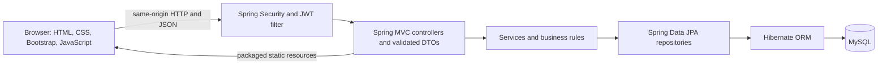
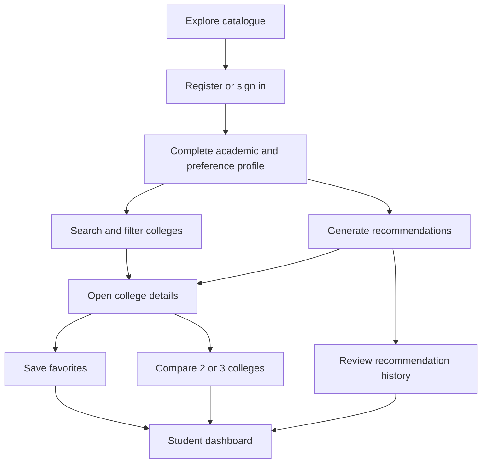

# CollegeWise — Smart College Comparison & Career Guidance System

**Developed by Rahul Chandra Sharma & Team**

[](https://www.oracle.com/java/technologies/javase/jdk17-archive-downloads.html)
[](https://spring.io/projects/spring-boot)
[](https://maven.apache.org/)
[](https://www.mysql.com/)

CollegeWise is a Java full-stack capstone for exploring Indian engineering colleges. Students can filter a seeded catalogue, compare colleges, save favorites, and review explainable profile-fit recommendations. Spring Boot serves both the REST API and the static HTML/CSS/JavaScript interface from one application.

> Fees, placement values, rankings, and cutoffs in the demonstration catalogue are illustrative. Recommendation scores are rule-based fit guidance and are not admission probabilities or guarantees. Confirm current information with each institution.

## Contents

- [Features](#features)
- [Technology](#technology)
- [Architecture](#architecture)
- [Student journey](#student-journey)
- [Recommendation method and limits](#recommendation-method-and-limits)
- [Data model](#data-model)
- [Project structure](#project-structure)
- [Requirements](#requirements)
- [Setup and run on Windows](#setup-and-run-on-windows)
- [Demo accounts](#demo-accounts)
- [API reference](#api-reference)
- [Verification](#verification)
- [Screenshots](#screenshots)
- [Security notes](#security-notes)
- [Limitations and future work](#limitations-and-future-work)
- [Troubleshooting](#troubleshooting)
- [Contributing](#contributing)
- [Attribution](#attribution)
- [License](#license)

## Features

| Area | Implemented capabilities |
| --- | --- |
| Student access | Registration, login, logout, BCrypt password storage, JWT authentication, HttpOnly browser cookie, profile retrieval and update |
| College discovery | Paginated listing, text search, state/city, fee and hostel filters, sorting, detail view |
| Planning | Explainable recommendations and history, favorites, comparison of two or three colleges |
| Administration | Role-protected dashboard and college, course, branch, cutoff and placement CRUD; user listing and active-state management |
| Demo data | Idempotent sample catalogue with 20 colleges and related course, branch, cutoff and placement data |
| Interface | HTML5, CSS3, Bootstrap 5 and vanilla JavaScript, served as Spring Boot static resources |

The checklist reflects the implemented API and automated/live API checks. A complete authenticated UI journey in a real browser has **not** been verified in the latest recorded audit; see [Verification](#verification).

## Technology

- **Frontend:** HTML5, CSS3, Bootstrap 5, vanilla JavaScript
- **Backend:** Java 17, Spring Boot 3.3.5, Spring MVC, Spring Security, Spring Data JPA, Hibernate, Jakarta Validation
- **Authentication:** JWT, BCrypt, HttpOnly and SameSite cookie for browser sessions
- **Application database:** MySQL 8+ with MySQL Connector/J
- **Automated test database:** H2, test scope only
- **Build:** Maven

The running application does not need Node.js or a separate frontend server. The repository retains legacy project material under `backend/`; it is not used to run the Spring Boot application.

## Architecture



Spring Boot is the single application process. Controllers expose DTOs, services apply application rules, repositories access persisted data, and Hibernate maps entities to MySQL. H2 is configured only in the test resources.

## Student journey



## Recommendation method and limits

Recommendations use deterministic, rule-based scoring from profile and catalogue fields. Factors include affordability, preferred state/city, course and branch compatibility, hostel preference, ranking, comparable entrance cutoff, and available placement outcomes. The current scoring weights and compatibility statuses are documented in [RECOMMENDATION_ALGORITHM.md](RECOMMENDATION_ALGORITHM.md).

The result is a screening aid, not a machine-learning model or an admission chance estimate. Missing or non-comparable cutoff information is reported as insufficient data. The system does not score school percentages against eligibility criteria because that data is not modeled. Catalogue values and cutoffs are demo data and need institution-level verification.

## Data model

The main entities are `User`, `StudentProfile`, `College`, `Course`, `Branch`, `Cutoff`, `Placement`, `Favorite`, and `RecommendationHistory`. A college has branches and related cutoff/placement records; student-owned favorites and recommendation history are associated with a user. See [DATABASE_SCHEMA.md](DATABASE_SCHEMA.md) for the relationship details.

## Project structure

```text
src/main/java/com/collegewise/      Spring Boot application, API, security, services, entities
src/main/resources/static/          HTML, CSS, and browser JavaScript served by Spring Boot
src/main/resources/                  MySQL runtime configuration and demo data
src/test/java/com/collegewise/       API, security, and recommendation tests
src/test/resources/                  Isolated H2 test configuration
backend/                             Retained legacy Node project files; not used at runtime
API_DOCUMENTATION.md                 REST endpoint summary
SETUP_GUIDE.md                       Windows, MySQL, configuration, and run instructions
TESTING.md                           Commands and recorded verification results
DATABASE_SCHEMA.md                   Entity and relationship overview
PROJECT_ARCHITECTURE.md              Additional architecture notes
RECOMMENDATION_ALGORITHM.md          Scoring factors and limitations
```

## Requirements

- JDK 17
- Maven 3.9 or later
- MySQL 8 or later
- Windows PowerShell or Command Prompt

## Setup and run on Windows

1. Create a local MySQL schema and application user as described in [SETUP_GUIDE.md](SETUP_GUIDE.md).
2. Configure `DB_URL`, `DB_USERNAME`, `DB_PASSWORD`, and a random `JWT_SECRET` of at least 32 bytes. Spring Boot does not load `.env` automatically. Keep secret values in Windows environment variables and do not commit them.
3. Open a new terminal so it receives the configured variables. From the repository root:

   ```powershell
   mvn clean test
   mvn clean package
   mvn spring-boot:run
   ```

4. Open [http://localhost:8080](http://localhost:8080). The health endpoint is [http://localhost:8080/api/health](http://localhost:8080/api/health).

For a packaged start, run `java -jar target\collegewise-1.0.0.jar` after setting the same environment variables. See [SETUP_GUIDE.md](SETUP_GUIDE.md) for complete PowerShell and Command Prompt setup, test-schema instructions, and troubleshooting. Runtime uses MySQL; the application does not silently fall back to H2.

## Demo accounts

There are no default credentials. Student registration creates a student account. A local demo student can be provisioned only with the `demo` Spring profile and the documented `DEMO_STUDENT_EMAIL` / `DEMO_STUDENT_PASSWORD` variables. Admin bootstrap uses `ADMIN_EMAIL` / `ADMIN_PASSWORD`. Bootstrap creates an account only if the email is new and does not reset existing passwords. Follow the masked password setup in [SETUP_GUIDE.md](SETUP_GUIDE.md); never put actual passwords in source, chat, or Git.

## API reference

JSON endpoints are rooted under `/api`; see [API_DOCUMENTATION.md](API_DOCUMENTATION.md) for the endpoint list and [POSTMAN_COLLECTION.json](POSTMAN_COLLECTION.json) for request examples. Public endpoints include health and college discovery. Student and admin routes require authentication, with administrator routes restricted by server-side role checks.

## Verification

Latest local automated validation on **2026-10-12**:

- `mvn clean test`: **PASS**, 14 tests, zero failures/errors/skips, using H2.
- `mvn clean package`: **PASS**.
- `node --check`: **PASS** for all four frontend scripts.
- MySQL API workflows: **PASS** in the isolated temporary schema as recorded on 2026-10-11. The configured `collegewise` schema was not used for test writes; the temporary schema was removed after the run.
- Authenticated browser UI journey: **NOT VERIFIED**. The live workflow used HTTP API clients, not browser automation.

See [TESTING.md](TESTING.md) for scope and limitations. Passing automated tests and API checks do not certify the illustrative catalogue data.

## Screenshots

No screenshots are checked into this repository. Add genuine screenshots after capturing the running application; do not use mockups as evidence of tested behavior.

## Security notes

- Runtime credentials and JWT signing material come from environment variables; `.env` and local credential files are ignored.
- Passwords are stored with BCrypt and are not returned by the API.
- Browser authentication uses an HttpOnly, SameSite cookie. JavaScript does not read the authentication cookie; the UI stores only display name/role in tab storage.
- API clients can also use the bearer token returned on login. Stateless bearer tokens cannot be revoked before expiry; browser logout clears the browser cookie.
- Tests use isolated H2. Live CRUD checks must use a separate local test schema, never production data.

## Limitations and future work

- Email verification, password reset, refresh tokens, and server-side token revocation are not implemented.
- Catalogue ranking, fees, cutoffs, and placement figures are illustrative; an institution may change them.
- The recommendation score is rule-based and does not predict admission outcomes.
- Authenticated browser journeys and responsive behavior still need a manual or automated browser audit.
- Hibernate schema update is suitable for this capstone, not a production migration strategy; production deployment should use reviewed database migrations and operational controls.

## Troubleshooting

| Symptom | Check |
| --- | --- |
| Application cannot connect to MySQL | Confirm MySQL is running, schema/user grants exist, and `DB_URL`, `DB_USERNAME`, and `DB_PASSWORD` are present in the terminal process. Do not print the password while diagnosing. |
| Missing configuration error at startup | Open a new terminal after setting Windows User environment variables and verify variable presence without displaying values. |
| Port 8080 is already in use | Stop the process that owns the port or set `SERVER_PORT` for this process. |
| Tests try to connect to MySQL | Check that the Maven run uses `src/test/resources/application.properties`; automated tests should use the isolated H2 profile/configuration. |
| Admin login does not work | Confirm `ADMIN_EMAIL` and `ADMIN_PASSWORD` were set before first startup. Bootstrap does not reset an existing account password. |

More detailed steps are in [SETUP_GUIDE.md](SETUP_GUIDE.md).

## Contributing

This is a personal capstone repository. For a proposed correction, open an issue or pull request with a concise description, reproduction steps, and relevant test results. Do not include real student data, credentials, or database dumps. Preserve existing history and third-party notices.

## Attribution

**CollegeWise — Smart College Comparison & Career Guidance System**
**Developed by Rahul Chandra Sharma & Team**

The preserved Git history includes earlier CollegeWise work credited to Aman Pushpakar and references to `amanpandaverse/CollegeWise`. The attribution above refers to the Java implementation and project changes maintained by Rahul Chandra Sharma & Team; it does not claim authorship of that earlier work or third-party material. Preserve applicable notices and licenses.

## License

No `LICENSE` file or project license statement is present. Do not assume that this repository grants reuse rights; preserve any third-party license terms. Add a project license only after its intended terms are established.

## Latest verification — 2026-10-12

- `mvn clean test`: **PASS**, 14 tests, zero failures/errors/skips, using H2.
- `mvn clean package`: **PASS**.
- JavaScript syntax: **PASS**, all four frontend scripts.
- Live MySQL startup and catalogue: **PASS** against the isolated `collegewise_test` schema on localhost; the configured `collegewise` schema was not targeted.
- Student discovery and authenticated browser journey: **PASS** in the actual browser, including registration/login/logout, profile update, recommendations and reasons, history, favorites add/remove, college details, filtering, three-college comparison, and four-college validation.
- Admin browser journey: **PARTIAL**. Admin sign-in, dashboard, and create/edit screens for college, course, branch, cutoff, and placement passed. Dashboard counters now refresh after saves and when Reload is pressed. The UI Delete click was not exercised; protected delete/cascade behavior is covered by the automated regression test. See [TESTING.md](TESTING.md).
- Browser diagnostics: zero application-origin console errors; no horizontal overflow at the 714-pixel viewport. A dedicated phone-size check is not verified.

See [TESTING.md](TESTING.md) for exact scope. Recommendation scores are rule-based fit guidance, not admission guarantees; seeded fees, rankings, placement values, and cutoffs are illustrative.
